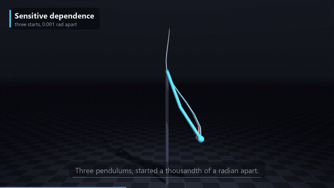
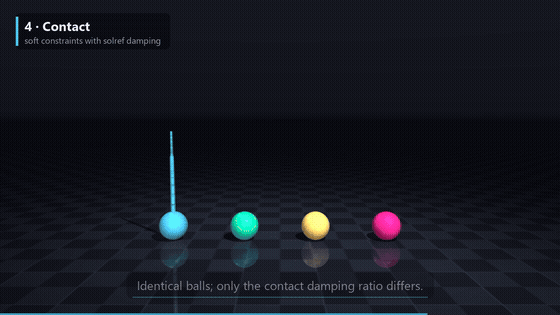
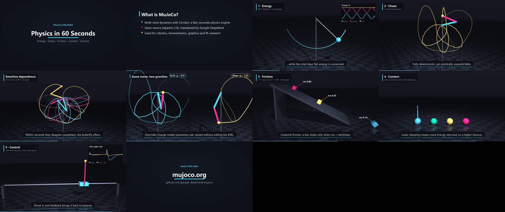

# MuJoCo Explainer Skills

**Agent skills that turn a physics idea into a polished explainer video, simulated with
[MuJoCo](https://mujoco.org/) ([google-deepmind/mujoco](https://github.com/google-deepmind/mujoco)).**

Describe a concept ("explain chaos", "show how LQR balances a cart-pole", "why do boxes slide on a ramp?")
and an agent such as Claude Code plans the story, builds or picks camera-ready MJCF scenes, writes a YAML
storyboard, renders it, *looks at* the result, and iterates until it reads well. One command
produces an H.264 MP4, an SRT caption file and a contact sheet.

<p align="center">
  
  
</p>

▶ **Sample outputs:** [`physics_in_60s.mp4`](docs/media/physics_in_60s.mp4) (61 s, 10 shots) ·
[`where_does_energy_go.mp4`](docs/media/where_does_energy_go.mp4) (narrated with offline TTS)



## The skills

| Skill | What it gives the agent |
|---|---|
| [`mujoco-explainer-video`](skills/mujoco-explainer-video/SKILL.md) | The render pipeline: storyboard YAML → MuJoCo offscreen render → overlays → MP4/SRT. It provides title and bullet cards, cinematic camera moves, motion **trails**, **3D-anchored callouts**, **live plots** (energy preset or any expression), side-by-side **compare** shots with parameter overrides, Python **controllers** (generic LQR included), scripted **pushes**, offline **TTS narration** and music mixing. It also ships a library of 6 tested scenes. |
| [`mujoco-scene-authoring`](skills/mujoco-scene-authoring/SKILL.md) | Writing MJCF that looks good on camera and simulates honestly: a shared visual template, an MJCF cheatsheet, and `validate_scene.py`. The validator lists the names a storyboard can reference, checks for NaN, penetration and energy drift, and renders a 2×2 preview sheet. |
| [`mujoco-physics-storyboarding`](skills/mujoco-physics-storyboarding/SKILL.md) | Planning the narrative: hook → setup → demonstration → contrast → takeaway, caption rules, and a **concept catalog** mapping two dozen ideas (energy, chaos, friction, restitution, integrators, LQR, IK…) to the scene, the parameter to vary, the overlay that proves the claim, and the pitfalls. |

## Install

```bash
git clone https://github.com/Yash-Kavaiya/mujoco-explainer-skills
cd mujoco-explainer-skills
pip install -r requirements.txt          # mujoco, numpy, pillow, imageio(+ffmpeg), pyyaml, pyttsx3
```

**Any agent, via [skills.sh](https://skills.sh/yash-kavaiya/mujoco-explainer-skills)**

```bash
npx skills add yash-kavaiya/mujoco-explainer-skills
```

**Claude Code, as a plugin**

```
/plugin marketplace add Yash-Kavaiya/mujoco-explainer-skills
/plugin install mujoco-explainer-skills@mujoco-explainer-skills
```

**Claude Code, as plain skills:** copy (or symlink) the folders in `skills/` into `~/.claude/skills/`
for personal use, or into `<project>/.claude/skills/` for one project. Any agent that reads `SKILL.md` files
can use them the same way.

Headless Linux / CI needs an OpenGL backend: `export MUJOCO_GL=egl` (GPU) or `MUJOCO_GL=osmesa` (CPU).

## Use it

Ask your agent:

> Make a 60-second explainer video about why a double pendulum is chaotic, using MuJoCo.

Or drive the pipeline yourself:

```bash
# fast half-res preview, then look at out/*_contact.png
python skills/mujoco-explainer-video/scripts/make_video.py examples/physics-in-60-seconds/storyboard.yaml --preview
# final render
python skills/mujoco-explainer-video/scripts/make_video.py examples/physics-in-60-seconds/storyboard.yaml
# narrated example (offline TTS via pyttsx3)
python skills/mujoco-explainer-video/scripts/make_video.py examples/where-does-energy-go/storyboard.yaml --tts
```

A storyboard is short:

```yaml
output: out/pendulum.mp4
resolution: [1280, 720]
shots:
  - {type: title, kicker: "Physics", title: "Energy in a Pendulum", duration: 3}
  - type: sim
    scene: "@scenes/pendulum.xml"
    duration: 6
    heading: "Energy sloshes, total stays put"
    camera: {lookat: [0, 0, 1.2], distance: [3.6, 3.0], azimuth: [80, 100], elevation: -10}
    trails: [{site: bob, length: 50}]
    plot: energy
    captions:
      - {t: 0.4, text: "Kinetic and potential energy trade places..."}
      - {t: 3.2, text: "...but their sum is constant."}
```

Full reference: [`storyboard-spec.md`](skills/mujoco-explainer-video/references/storyboard-spec.md) ·
starter: [`templates/storyboard.yaml`](skills/mujoco-explainer-video/templates/storyboard.yaml)

## Scene library

| Scene | Demonstrates | Named things |
|---|---|---|
| `pendulum.xml` | energy conservation (RK4, drift < 0.01%) | joint `swing`, site `bob` |
| `double_pendulum.xml` | chaos | `link1`, `link2`, site `tip` |
| `double_pendulum_twins.xml` | sensitive dependence (3 starts, 1e-3 rad apart) | sites `a_tip`, `b_tip`, `c_tip` |
| `friction_ramp.xml` | Coulomb friction vs tan θ | `box_ice`, `box_wood`, `box_rubber` |
| `bounce.xml` | contact damping / restitution | `ball_bouncy` … `ball_dead` |
| `cartpole.xml` + `controllers/lqr_balance.py` | unstable equilibrium and LQR from `mjd_transitionFD` | joints `slider`, `hinge`, actuator `push` |

## How it works

```
storyboard.yaml ──► pipeline.py ──► per shot:
                                    title/bullets ─► graphics.py (Pillow)
                                    sim/compare   ─► sim.py: MjModel + overrides ─► mj_step (controller, pushes)
                                                         └► mujoco.Renderer (+ trail geoms injected into MjvScene)
                                                         └► callouts projected from the GL camera, live plots
                ◄── fades, captions, progress bar ◄──┘
           imageio/ffmpeg (libx264, CRF 18) ─► mp4  ─► ffmpeg amix (TTS / voiceover / music) ─► final mp4 + .srt + contact sheet
```

Rendering is deterministic, so the same storyboard always gives the same video. A `--preview` of the 61 s showcase
renders in about a minute on a laptop, which is fast enough to iterate on.

## License

Apache-2.0. MuJoCo is developed by Google DeepMind and also licensed under Apache-2.0. This project is
an independent community toolkit and is not affiliated with or endorsed by Google DeepMind.
